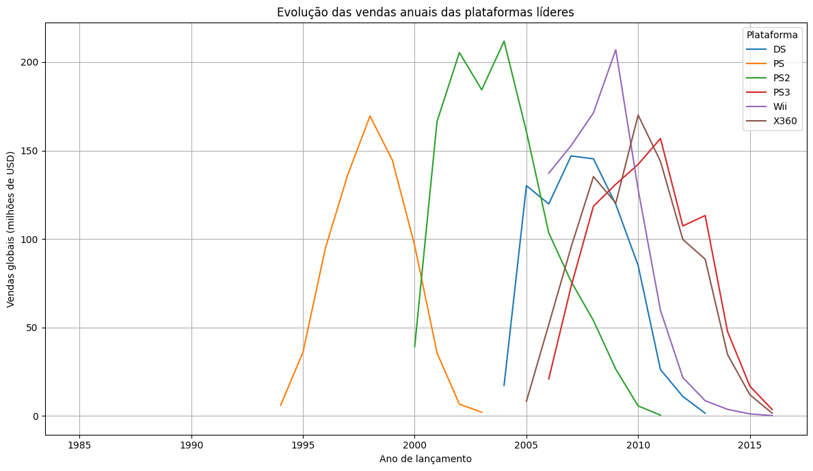
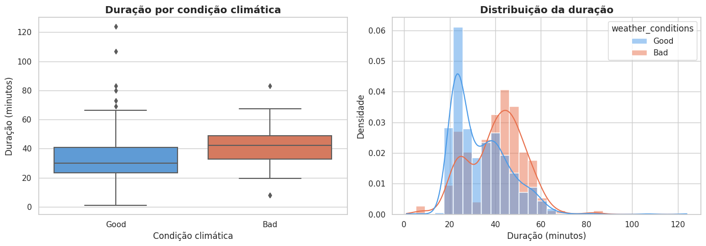
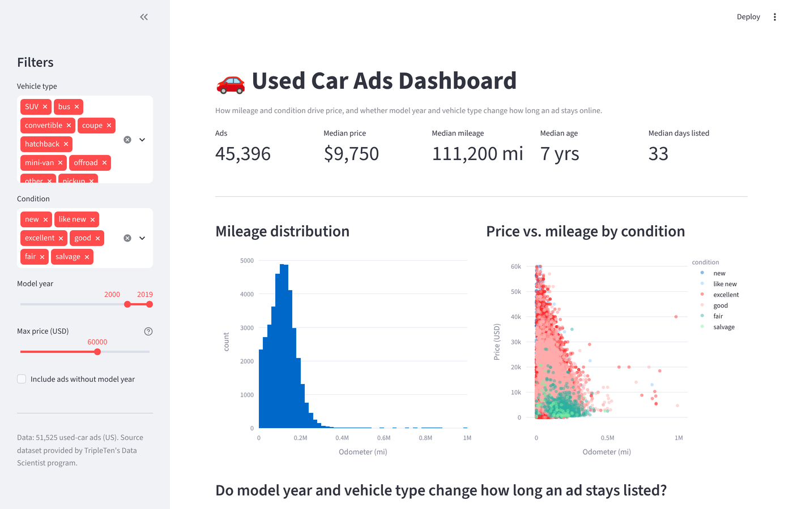
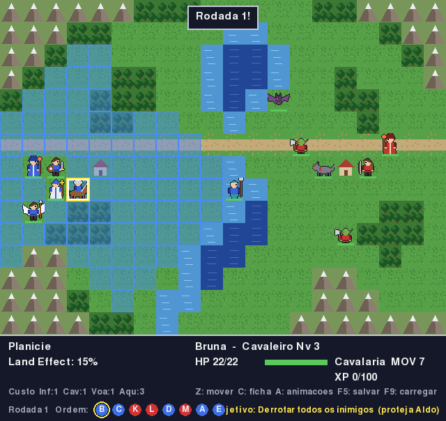

<h1 align="center">Edson Moraes</h1>

<b>Data Analyst / Data Scientist in training · 25 years as a software engineer (since 2001) · 15 years turning ERP data into decisions</b>

---

## About me

I spent 15 years inside **Microsoft Dynamics AX / 365** at manufacturing, agribusiness and software companies, which means I have been living with enterprise data the whole time: fiscal and tax reporting, supply-chain transactions, financial integrations, SQL Server performance. In 2026 I decided to make data the main job, not the side effect, and enrolled in the **Data Scientist program at TripleTen** while building the projects below.

What I bring that a career-starter usually does not:

- **Business context.** I know what the numbers in an ERP mean, where they come from and why they are wrong.
- **Engineering discipline.** Tests, versioning, documented decisions, reproducible notebooks, deployed apps.
- **SQL at production scale.** Query tuning, index analysis and integration pipelines on real company databases, not just exercises.

---

## Featured data projects

### 🎮 [Video Game Sales Analysis — EDA & Hypothesis Testing](https://github.com/artraxia/video-game-sales-analysis)

End-to-end exploratory analysis of **16,700 game titles (1980–2016)** to decide where a retailer should put its 2017 marketing budget.
Data cleaning (types, `tbd` scores, missing ratings), platform life-cycle modelling to pick the 2013–2016 analysis window, regional user profiles (NA / EU / JP), ESRB impact, and two **t-tests** on user scores. Reviewer-approved course capstone.

> **Key findings:** platforms live ~4–6 years; PS4 and Xbox One lead the West on Action/Shooter/Sports titles with M/E ratings, while Japan runs on 3DS and RPGs; critic scores correlate moderately with sales, user scores barely at all.

`pandas` `NumPy` `Matplotlib` `SciPy` `Jupyter`

### 🚕 [Chicago Taxi Rides — Scraping, SQL & Hypothesis Testing](https://github.com/artraxia/chicago-taxi-rides-analysis)

Market study for a ride-sharing launch in Chicago, built in three layers: **web scraping** of hourly weather records, **six PostgreSQL queries** joining cabs, trips, neighborhoods and weather, and a **Python analysis** of competitors and destinations ending in a **Welch t-test**. Reviewer-approved course project.

> **Key findings:** the market is concentrated (Flash Cab 14.2%, top 5 = 44.1%); 76.7% of destinations fall in 10 downtown neighborhoods; on rainy Saturdays Loop → O'Hare rides take **+7 min (+21%)**, p = 2.4 × 10⁻¹¹, robust to outlier removal.

`pandas` `SciPy` `requests` `BeautifulSoup` `PostgreSQL` `Jupyter`

### 🚗 [Used Car Ads Dashboard — Streamlit](https://github.com/artraxia/used-car-ads-streamlit-dashboard) · [live demo](https://pythonrendertest-mgx1.onrender.com)

Interactive dashboard over **51k US used-car listings**: mileage distribution, price vs. odometer by condition, and whether model year and vehicle type change how long an ad stays online (OLS trendline, boxplots, group means). Deployed on Render.

`Streamlit` `Plotly` `pandas` `statsmodels` `Render`

### 🗄️ [SQL Data Analysis — PostgreSQL](https://github.com/artraxia/sql-data-analysis-postgresql)

25 business questions answered in PostgreSQL: running totals and rankings with **window functions**, `CASE` imputation, multi-table **joins** with timestamp casting, anti-joins with subqueries, `UNION` / `UNION ALL`, `GROUP BY` / `HAVING`, and the Chicago taxi (Zuber) project queries with `DATE_TRUNC` and `EXTRACT(DOW)`.

`PostgreSQL`

### 🕸️ [Web Scraping with Python](https://github.com/artraxia/web-scraping-beautifulsoup-pandas) · [Python Data Fundamentals](https://github.com/artraxia/python-data-fundamentals)

Data collection from HTML with regex and BeautifulSoup into pandas; OOP, file I/O and REST API consumption with `requests` / JSON.

`requests` `BeautifulSoup` `pandas`

---

## Software engineering

### ⚔️ [Force Tactics — Tactical RPG in Python](https://github.com/artraxia/force-tactics)

Turn-based tactical RPG built from scratch: a **pure-Python rules engine** (terrain costs, pathfinding, combat formulas, turn order, enemy AI, campaign save/load) fully separated from the **pygame-ce** presentation layer, maps authored in Tiled, **77 pytest tests**, and simulation tools for balancing (AI-vs-AI autoplay, duel reports). ~5k lines.

`Python 3.12` `pygame-ce` `Tiled` `pytest`

---

## Enterprise data experience (Dynamics AX / 365, 2011–present)

Selected work on client systems — companies not named by agreement.

| Context | What I did | Data skills involved |
|---|---|---|
| **D365 F&O ISV, performance-monitoring product** (US) | Designed and built the database-statistics module of a performance tool: SQL Server index usage, fragmentation, file growth and missing-index analysis, surfaced in an **embedded Power BI dashboard**; wrote regression-test evidence logs with exact row counts and measurements | SQL Server DMVs, query design, Power BI, metrics definition, experiment documentation |
| **Global agricultural machinery manufacturer** | Dynamics 365 CE / Field Service engineering with CI/CD on GitHub Actions; uses Copilot agents to speed up delivery and field data capture | Dataverse data model, integration pipelines, automation |
| **Brazilian manufacturing clients (D365 F&O)** | Rebuilt **SPED Fiscal** (statutory tax reporting) routines: +20% performance and testable code; supply-chain integration redesign with ~30% faster processing | Large-volume fiscal data, reconciliation, performance tuning |
| **Financial integrations** | Azure Functions service integrating D365 with Brazil's instant-payment system (Pix); Power Platform flows pushing ERP events to Teams | REST/JSON pipelines, event-driven data, monitoring |
| **AX 4 → 2009 → 2012 → D365 migrations** | Data migration and validation across ERP versions | Data mapping, quality checks, SQL |

---

## Skills

| | |
|---|---|
| **Analysis** | pandas, NumPy, SciPy, statistics & hypothesis testing, EDA, data cleaning, Matplotlib, Plotly, Streamlit, Power BI, Jupyter |
| **Data engineering** | SQL (PostgreSQL, SQL Server, T-SQL), query optimisation, REST APIs, Azure Functions, Power Platform, web scraping |
| **Software** | Python, X++, C#/.NET, Git/GitHub, GitHub Actions, pytest, OOP, clean architecture |
| **Learning now** | scikit-learn & machine learning (TripleTen, Sprint 8+), Azure AI (Foundry, agents) |
| **Languages** | Portuguese (native) · English (professional) · German (A1, studying) |

---

Projects are published under <b>Artraxia</b>, the company through which I deliver consulting work. The name comes from <i>ataraxia</i>: calm, steady delivery.

